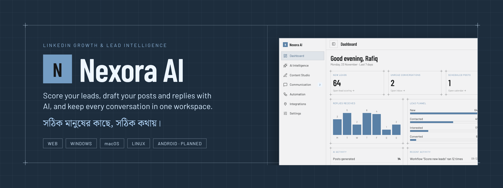
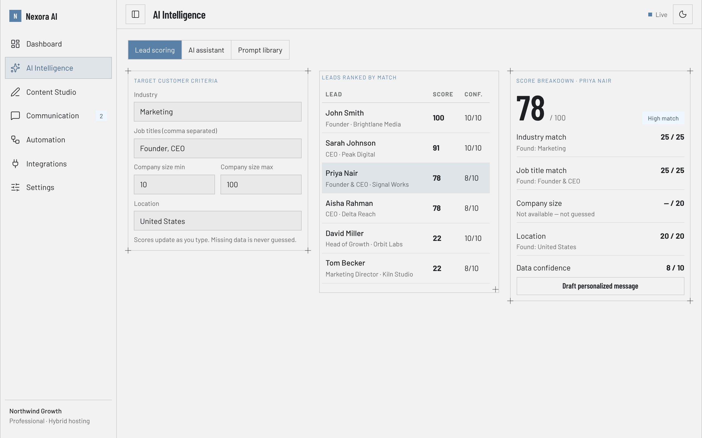
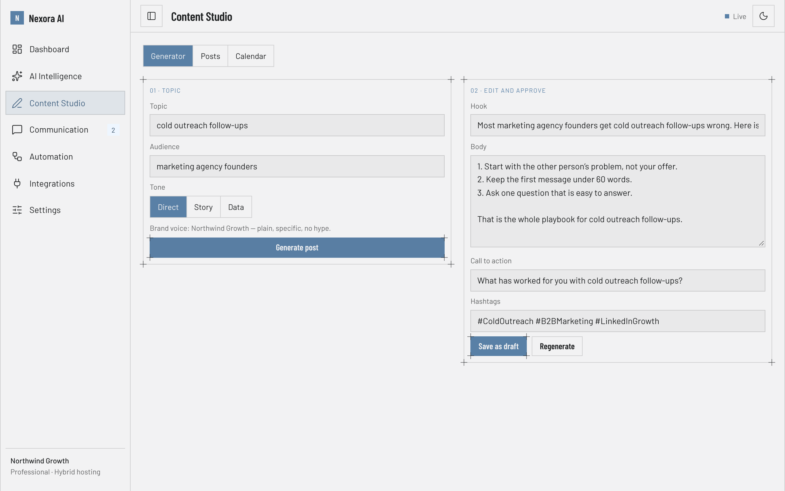
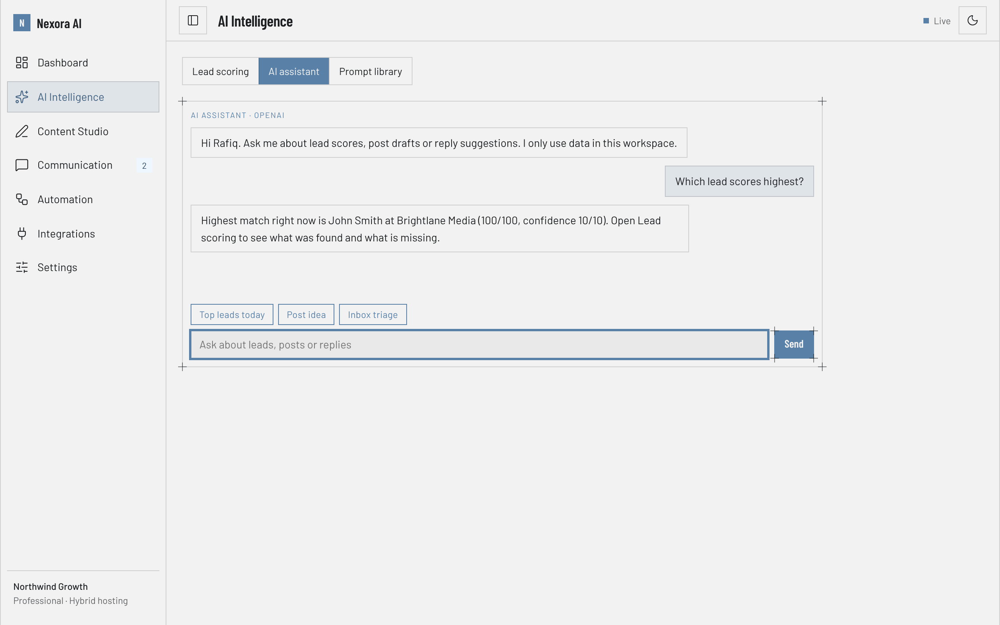
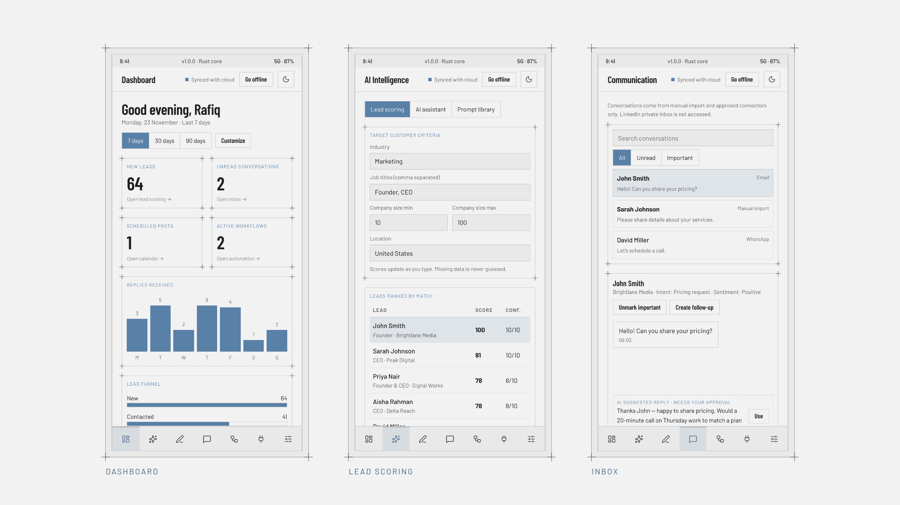

<p align="center">
  
</p>

<p align="center">
  <a href="README.md">Read in English</a> ·
  <a href="#এক-নজরে-দেখুন">ডেমো</a> ·
  <a href="#ডাউনলোড">ডাউনলোড</a> ·
  <a href="#প্ল্যান-এবং-কেন-সাবস্ক্রিপশন-দরকার">প্ল্যান</a> ·
  <a href="#সামনে-যা-আসছে">সামনের পরিকল্পনা</a>
</p>

# নেক্সোরা এআই (Nexora AI)

**নেক্সোরা এআই হলো LinkedIn-এর মাধ্যমে ব্যবসা বাড়ানোর একটি কাজের জায়গা (workspace)।** কোন লিডের
পেছনে সময় দেওয়া উচিত তা এটি দেখিয়ে দেয়, AI দিয়ে পোস্ট ও উত্তর লিখতে সাহায্য করে, সব কথোপকথন এক
ইনবক্সে রাখে — এবং LinkedIn যা অনুমতি দেয় না, এমন কিছু কখনো করে না।

একই অ্যাপ্লিকেশন ব্রাউজারে, Windows, macOS ও Linux-এ ডেস্কটপ অ্যাপ হিসেবে এবং Android-এ চলে; সব
জায়গায় একই ডেটা। তৈরি করেছেন [Mostafijemon24](https://github.com/Mostafijemon24)।

<p align="center">
  
</p>

## এক নজরে দেখুন

<p align="center">
  
</p>

<p align="center"><sub>৩৭ সেকেন্ডের ট্যুর: অ্যাক্টিভেশন, ড্যাশবোর্ড, লিড স্কোরিং, পোস্ট লেখা, উত্তর দেওয়া, অটোমেশন, ডার্ক মোড।
<a href="docs/media/nexora-ai-tour.mp4">ভিডিও ডাউনলোড করুন (MP4)</a></sub></p>

## কাদের জন্য

- **উদ্যোক্তা ও একক পরামর্শদাতা** — যাঁরা LinkedIn থেকে ক্লায়েন্ট পান, কিন্তু লম্বা লিড-তালিকা হাতে বাছাই করার সময় নেই।
- **ছোট এজেন্সি ও সেলস টিম** — যাঁরা লিড, কনটেন্ট ও উত্তর এক জায়গায় চান।
- **যাঁরা নিজের LinkedIn অ্যাকাউন্ট ঝুঁকিতে ফেলতে চান না** — স্ক্র্যাপিং টুল বা অটো-ক্লিকার ব্যবহার না করে।

## কোন সমস্যার সমাধান করে

| নেক্সোরা এআই ছাড়া | নেক্সোরা এআই দিয়ে |
| --- | --- |
| ৫০০ লিডের তালিকা, কিন্তু কাকে আগে যোগাযোগ করবেন জানা নেই | প্রতিটি লিডের ০–১০০ স্কোর, কারণসহ |
| প্রতিবার পোস্ট লিখতে গিয়ে খালি পাতা | কয়েক সেকেন্ডে আপনার ব্র্যান্ডের ভাষায় খসড়া পোস্ট |
| উত্তর ছড়িয়ে আছে ইমেইল, WhatsApp ও নোটে | এক ইনবক্স, প্রতিটি কথোপকথনের জন্য প্রস্তাবিত উত্তর |
| ফলো-আপ ভুলে যাওয়া | Workflow নিজে থেকে টাস্ক তৈরি করে, লিড সরায়, বার্তার খসড়া করে |
| CRM, ক্যালেন্ডার আর মেইলবক্স কখনো মেলে না | HubSpot, Salesforce ও Google Calendar-এর সাথে দ্বিমুখী সিঙ্ক; ইমেইল ও WhatsApp এক ইনবক্সে |
| স্ক্র্যাপিং টুলে অ্যাকাউন্ট সীমিত হওয়ার ঝুঁকি | শুধু অফিসিয়াল সংযোগ ও নিজের হাতে করা ধাপ |
| ইন্টারনেট নেই, কাজ বন্ধ | ডেস্কটপ অ্যাপ অফলাইনে চলে, পরে নিজে থেকে সিঙ্ক হয় |

## কী কী করা যায়

### কার সাথে আগে কথা বলবেন তা জানুন



আপনার আদর্শ গ্রাহকের বর্ণনা একবার দিন — ইন্ডাস্ট্রি, পদবি, কোম্পানির আকার, অবস্থান। প্রতিটি লিড ১০০-র
মধ্যে একটি স্কোর পায়, সাথে হিসাবের ভাঙন। আলাদা একটি **কনফিডেন্স** সংখ্যা দেখায় স্কোরটি কতটা তথ্যের
ওপর দাঁড়িয়ে। কোনো তথ্য না থাকলে অ্যাপ লেখে *"Not available — not guessed"* এবং তার জন্য কোনো পয়েন্ট
দেয় না; কখনো বানিয়ে তথ্য বসায় না।

### প্রতিটি লিডকে এগিয়ে রাখুন

প্রতিটি লিডের একটি ধাপ আছে — New, Contacted, Interested, Converted বা Lost — সাথে যোগাযোগের তথ্য,
ট্যাগ ও নোট। তালিকায় খুঁজুন ও ফিল্টার করুন, একসাথে অনেক লিড বদলান, pipeline-এ টেনে সরান, আর
ক্যাম্পেইনে ভাগ করুন — কতজনের সাথে যোগাযোগ হলো, কতজন উত্তর দিল, কতজন গ্রাহক হলো তা দেখা যায়।
আনা-নেওয়া সাধারণ CSV ফাইলে।

### খালি পাতা ছাড়াই পোস্ট লিখুন



বিষয়, পাঠক ও সুর (tone) দিন। হুক, মূল লেখা, কল-টু-অ্যাকশন ও হ্যাশট্যাগ পাবেন — সবই সম্পাদনাযোগ্য।
পোস্ট যায় **Draft → In review → Approved → Scheduled → Published** ধাপে, আর সাপ্তাহিক ক্যালেন্ডারে
দেখা যায় কোনটি কবে যাবে। LinkedIn যুক্ত থাকলে অনুমোদিত পোস্ট LinkedIn-এর অফিসিয়াল API দিয়ে প্রকাশ হয় —
আপনি Publish চাপলে, অথবা চালু করে রাখলে নির্ধারিত দিনে নিজে থেকে। আপনার অনুমোদন ছাড়া কিছুই প্রকাশ হয় না।


### এক জায়গা থেকে সব কথোপকথনের উত্তর দিন


নিজের মেইলবক্স ও WhatsApp Business নম্বর যুক্ত করুন: আসা বার্তা ইনবক্সে চলে আসে, যে লিডের কাছ থেকে
এসেছে তার সাথে যুক্ত হয়ে; আপনার উত্তর একই চ্যানেলে যায়, আর প্রতিটি উত্তরে দেখা যায় সেটি পাঠানো হয়েছে কি
না। AI একটি উত্তর প্রস্তাব করে, কিন্তু সেটি শুধুই প্রস্তাব: আপনি **Use** চাপবেন, সম্পাদনা করবেন, নিজে পাঠাবেন।

### সহকারীকে জিজ্ঞেস করুন



নিজের লিড, পোস্ট ও উত্তর নিয়ে প্রশ্ন করুন। সহকারী শুধু আপনার workspace-এর তথ্য ব্যবহার করে, আর কিছু
না থাকলে তা জানিয়ে দেয়।

### ফলো-আপ নিজে থেকে চলুক


ধাপ দিয়ে একটি workflow বানান: একটি ট্রিগার (নতুন লিড, ধাপ বদল, বার্তা আসা, পোস্টের স্ট্যাটাস, নির্ধারিত
সময়), তারপর শর্ত, অপেক্ষা, অনুমোদন ও কাজ — লিডে ট্যাগ দেওয়া বা সরানো, টাস্ক তৈরি, AI দিয়ে বার্তার
খসড়া, workspace-কে জানানো, webhook ডাকা। চালু করলে এটি নিজে থেকে চলে। অনুমোদনের ধাপের পরেই কেবল
বার্তা পাঠানো হয়, test run কিছু না বদলে দেখায় কী ঘটত, আর LinkedIn-এ কিছুই করা হয় না।

### নিজের টুল যুক্ত করুন, নিজের AI ব্যবহার করুন


HubSpot বা Salesforce (লিড দুই দিকেই সিঙ্ক হয়), Google Calendar (ফলো-আপ টাস্ক ক্যালেন্ডারে দেখা যায়),
ইমেইল, WhatsApp, n8n ও স্বাক্ষরিত webhook যুক্ত করুন। AI-এর জন্য নিজের key
ব্যবহার করবেন — **OpenAI, Google Gemini, Anthropic Claude বা OpenRouter** — কোন কাজে কোনটি চলবে তা
ঠিক করবেন, এবং মাসিক খরচের সীমা বসাবেন।


### পুরো ছবি এক পাতায়


ড্যাশবোর্ডে গত ৭, ৩০ বা ৯০ দিনের নতুন লিড, না-পড়া কথোপকথন, নির্ধারিত পোস্ট, লিড ফানেল ও টাস্ক
দেখা যায়। Reports পাতায় যোগাযোগ, উত্তর ও রূপান্তরের হার, ক্যাম্পেইনের ফল, চ্যানেল অনুযায়ী বার্তা ও
প্রোভাইডার অনুযায়ী AI খরচ দেখা যায় — সবই CSV হিসেবে নামানো যায়। লাইট ও ডার্ক — দুই থিমই আছে।

### দল নিয়ে কাজ করুন

একটি পাসওয়ার্ড বসান এবং সহকর্মীদের ইমেইলে আমন্ত্রণ জানান; প্রত্যেকে নিজের অ্যাকাউন্ট দিয়ে সাইন-ইন করেন
এবং লাইসেন্সের একটি আসন নেন — লাইসেন্স key না দেখেই। রোল (owner, admin, member, viewer) ঠিক করে কে
কী বদলাতে পারবেন। Authenticator অ্যাপ দিয়ে দুই ধাপের সাইন-ইন প্রত্যেকে আলাদা করে চালু করতে পারেন, বা
সবার জন্য বাধ্যতামূলক করা যায়। এজেন্সি প্রতিটি ক্লায়েন্টের জন্য আলাদা workspace রাখতে পারে।

### ইন্টারনেট ছাড়াও কাজ চালান


ডেস্কটপ অ্যাপে **Go offline** চাপুন বা সংযোগ চলে যাক: যা লিখবেন তা আপনার কম্পিউটারে জমা থাকে, এবং
সংযোগ ফিরলেই সার্ভারে চলে যায় — প্রতিটি পরিবর্তন ঠিক একবার।

### ফোনের মাপের পর্দায়



একই অ্যাপ ছোট পর্দায় নিজেকে সাজিয়ে নেয়, নিচে নেভিগেশন বারসহ — ফোনের ব্রাউজারে এবং Android অ্যাপে।

## কীভাবে কাজ করে

1. **অ্যাক্টিভেট করুন।** লাইসেন্স key একবার দিন, অথবা নিজের অ্যাকাউন্ট দিয়ে সাইন-ইন করুন। সার্ভার সেটি যাচাই করে আপনার ডিভাইস নিবন্ধন করে।
2. **কাজ করুন।** লিড, পোস্ট, কথোপকথন ও workflow সার্ভারে আপনার নিজস্ব workspace-এ থাকে, তাই ওয়েব ও ডেস্কটপে সবসময় একই জিনিস দেখা যায়।
3. **নিজের শর্তে AI ব্যবহার করুন।** AI-এর অনুরোধ সার্ভার দিয়ে যায় *আপনার* প্রোভাইডার key দিয়ে; key এনক্রিপ্ট করে রাখা হয় এবং কোনো ডিভাইসে আর ফেরত পাঠানো হয় না।
4. **নিয়ন্ত্রণ আপনার হাতে।** AI শুধু খসড়া করে। উত্তর পাঠানো, পোস্ট প্রকাশ, workflow অনুমোদন — সিদ্ধান্ত সবসময় আপনার।

## যা এটি কখনো করবে না

| ব্যবহার করে | ব্যবহার করে না |
| --- | --- |
| LinkedIn-এর অফিসিয়াল সাইন-ইন ও অনুমোদিত অনুমতি | আপনার LinkedIn পাসওয়ার্ড |
| CSV ইমপোর্ট, বার্তার খসড়া, রিমাইন্ডার | স্ক্র্যাপিং |
| যে চ্যানেল আপনি নিজে যুক্ত করেন | স্বয়ংক্রিয় ক্লিক বা গণ-কানেকশন রিকোয়েস্ট |
| | আপনার ব্যক্তিগত LinkedIn ইনবক্স পড়া |

## প্ল্যান এবং কেন সাবস্ক্রিপশন দরকার

সাবস্ক্রিপশন একবারের ডাউনলোড নয়; এটিই নেক্সোরা এআই-কে আপনার জন্য চালু রাখে। এর বিনিময়ে পাবেন:

- **আপনার লাইসেন্স** — যে key আপনার ডিভাইসে অ্যাপ খোলে এবং আপনার workspace সুরক্ষিত রাখে। এক লাইসেন্স একসাথে এক ডিভাইসে চলে; ইমেইলে আসা কোড দিয়ে নিজেই নতুন ডিভাইসে সরাতে পারবেন।
- **ক্লাউড workspace** — নিরাপদ সংরক্ষণ, ওয়েব ও ডেস্কটপের মধ্যে সিঙ্ক, এবং ব্যাকআপ।
- **AI-এর সার্ভার অংশ** — রাউটিং, ব্যবহারের হিসাব, খরচের সীমা ও এনক্রিপ্ট করা key সংরক্ষণ। (AI প্রোভাইডারের নিজস্ব খরচ আপনার নিজের key-তে প্রোভাইডারই নেয়, তাই যতটুকু ব্যবহার ততটুকুই খরচ।)
- **আপডেট ও নতুন ফিচার** — সামনের পরিকল্পনার সবকিছু, যখন যেটি আসবে।
- **সাপোর্ট** — কোনো সমস্যা হলে।

সক্রিয় লাইসেন্স ছাড়া অ্যাপ সব ডিভাইসে অ্যাক্টিভেশন স্ক্রিনেই থাকে।

| | Starter | Professional | Business |
| --- | --- | --- | --- |
| **মূল্য** | **$৯** / মাস | **$২৯** / মাস | **$৭৯** / মাস |
| লিড স্কোরিং, AI সহকারী, প্রম্পট লাইব্রেরি | ✓ | ✓ | ✓ |
| কনটেন্ট স্টুডিও ও ক্যালেন্ডার | ✓ | ✓ | ✓ |
| প্রস্তাবিত উত্তরসহ এক ইনবক্স | ✓ | ✓ | ✓ |
| নিজে থেকে চলা workflow, ইন্টিগ্রেশন ও সিঙ্ক | | ✓ | ✓ |
| ডেস্কটপ ও Android অ্যাপ, অফলাইন মোড | | ✓ | ✓ |
| টিম মেম্বার, রোল, একাধিক workspace (৫ ডিভাইস) | | | ✓ |
| অগ্রাধিকার সাপোর্ট | | | ✓ |

এই সীমাগুলো সার্ভারই প্রয়োগ করে। এ ছাড়া আছে বার্ষিক প্ল্যান, এককালীন মূল্যের **Lifetime desktop**
লাইসেন্স এবং **Enterprise** প্ল্যান (২৫ ডিভাইস, সব কিছু অন্তর্ভুক্ত)।

> এই মূল্য ও প্ল্যানের বিষয়বস্তু উদ্বোধনের জন্য পরিকল্পিত প্রস্তাব; প্রকাশের আগে বদলাতে পারে — বিশেষ করে
> বার্ষিক, lifetime ও enterprise-এর মূল্য আপাতত বসানো সংখ্যা। অনলাইন পেমেন্ট এখনো যুক্ত হয়নি — এখন
> লাইসেন্স সরাসরি মালিক ইস্যু করেন। তৃতীয় পক্ষের খরচ (AI প্রোভাইডার, LinkedIn API) আলাদা।

## ডাউনলোড

**Windows** (`.exe`, `.msi`), **macOS** (`.dmg`) ও **Linux** (`.deb`, `.rpm`, `.AppImage`)-এর ইনস্টলার
[Releases পাতায়](https://github.com/Mostafijemon24/Nexora-AI/releases) প্রকাশিত হয়। ওয়েব অ্যাপ:
**https://linkdin.avonixai.com**।

সার্ভার যুক্ত না করা পর্যন্ত ইনস্টলার ও ওয়েব অ্যাপ **সার্ভার ছাড়া চলে**। ঢুকতে `NXR-VALID-0001` key
ব্যবহার করুন। workspace খালি অবস্থায় শুরু হয়, আর প্রতিটি পেজ প্রথমবার খুললে একটি ছোট tour সেটি বুঝিয়ে
দেয় (header-এর **?** বোতামে আবার দেখা যায়)। আপনি যা যোগ করেন তা ওই ডিভাইসেই থাকে, আর অ্যাপ খোলা
থাকা অবস্থায় workflow চলে। সার্ভার ছাড়া কিছু যুক্ত করা বা পাঠানো যায় না — integration, AI provider-এর
key, ইমেইল, WhatsApp, অ্যাকাউন্ট ও টিম মেম্বার সবই সার্ভারে থাকে — আর AI-এর উত্তরগুলো অ্যাপে রাখা নমুনা।
সার্ভার ব্যবহার করতে প্রথম পর্দায় *Use a different server*-এ, অথবা Settings → Hosting and backups-এ
তার ঠিকানা দিন।

ইনস্টলারগুলো এখনো code-sign করা নয়, তাই Windows ও macOS প্রথমবার খোলার সময় সতর্কবার্তা দেখাবে।

**macOS-এ প্রথমবার খোলার সময়।** macOS যদি বলে অ্যাপটি যাচাই করা যায়নি, তাহলে **System Settings →
Privacy & Security**-এ গিয়ে **Open Anyway** চাপুন। আর যদি বলে *"Nexora AI.app" is damaged and can't
be opened*, তাহলে অ্যাপটি আসলে নষ্ট নয় — সাইন না করা ডাউনলোড macOS এভাবেই আটকায়। **Cancel** চাপুন
(*Move to Trash* নয়), অ্যাপটি **Applications**-এ সরান, তারপর Terminal-এ একবার এই কমান্ডটি চালিয়ে
অ্যাপটি আবার খুলুন:

```bash
xattr -cr "/Applications/Nexora AI.app"
```

## প্রোটোটাইপ চালিয়ে দেখুন

- **এই repository থেকে, ব্রাউজারে:** `npm install && npm run dev`, তারপর `http://localhost:1420` খুলে
  `NXR-VALID-0001` দিয়ে অ্যাক্টিভেট করুন। ঠিকানার শেষে `?platform=android` (বা `windows`, `macos`,
  `linux`) যোগ করলে সেই লেআউট দেখা যায়, আর `?sample` যোগ করলে workspace নমুনা ডেটায় ভরে যায়।
- **মূল ক্লিকযোগ্য ডিজাইন প্রোটোটাইপ:** [`design/`](design) ফোল্ডারটি ডাউনলোড করে `Nexora AI.dc.html`
  খুলুন।


## সামনে যা আসছে

আগের পরিকল্পনার product ফিচারগুলো তৈরি হয়ে গেছে। বাকি কাজের বেশিরভাগই আসল অ্যাকাউন্ট দিয়ে জিনিসগুলো
চালু করা — পূর্ণ তালিকা **[ROADMAP.md](ROADMAP.md)** ফাইলে।

| বাকি | এখন কী অবস্থা | কী লাগবে |
| --- | --- | --- |
| সার্ভার VPS-এ বসানো | এক কমান্ডে বসানোর ব্যবস্থা তৈরি; এখনো আসল সার্ভারে চালানো হয়নি | API-র জন্য DNS রেকর্ড, তারপর [deploy/README.md](deploy/README.md)-র কমান্ড |
| ইমেইল পাঠানো (কোড, আমন্ত্রণ) | SMTP না থাকলে সার্ভারের log-এ লেখা হয় | একটি SMTP অ্যাকাউন্ট |
| AI প্রোভাইডার | সংযোগ তৈরি, আসল key দিয়ে চালানো হয়নি | প্রতিটির একটি API key |
| LinkedIn, HubSpot, Salesforce, Google Calendar | সাইন-ইন, সিঙ্ক ও প্রকাশ তৈরি; আসল অ্যাকাউন্টে চালানো হয়নি | প্রতিটির ডেভেলপার অ্যাপ; LinkedIn-এর অনুমোদন |
| ইমেইল ও WhatsApp | পাঠানো ও গ্রহণ তৈরি; আসল সার্ভারে চালানো হয়নি | একটি মেইলবক্স, WhatsApp Business নম্বর |
| স্বয়ংক্রিয় আপডেট | তৈরি; signing key পেলে চালু হবে | নিজের কম্পিউটারে একবার key তৈরি করে repository-তে যোগ করা |
| Android release | debug build তৈরি ও পরীক্ষিত | upload keystore, Play Console অ্যাকাউন্ট |
| Code signing | সাইন করা নয়; সতর্কবার্তা দেখিয়ে খোলে | Windows সার্টিফিকেট, Apple Developer অ্যাকাউন্ট |
| অনলাইন পেমেন্ট | লাইসেন্স কমান্ড দিয়ে তৈরি করতে হয় | পেমেন্ট প্রোভাইডারের অ্যাকাউন্ট |

## লাইসেন্স

© ২০২৬ Mostafijemon24। সর্বস্বত্ব সংরক্ষিত।
