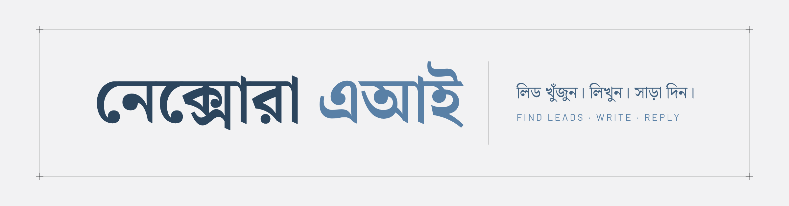
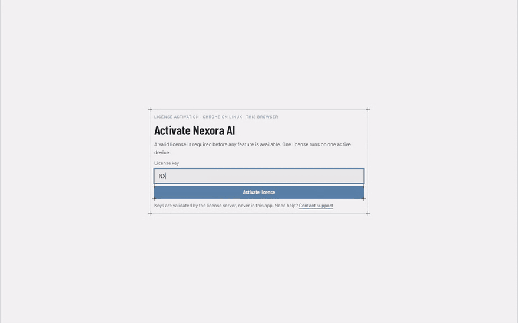
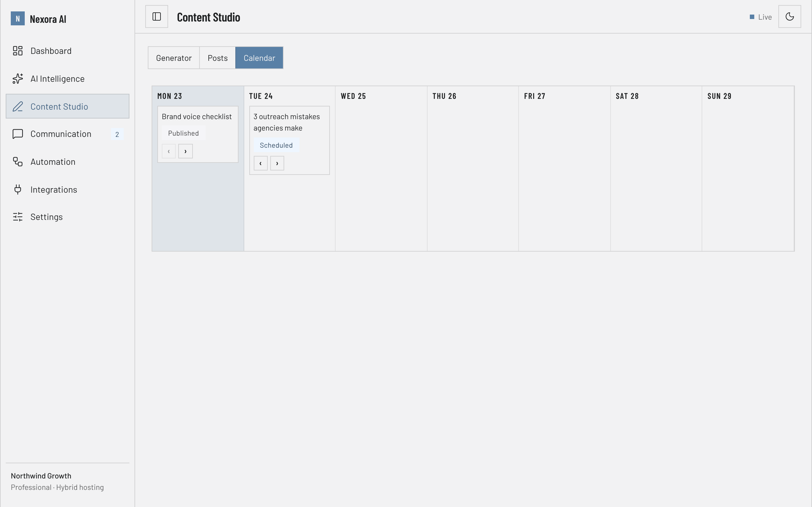
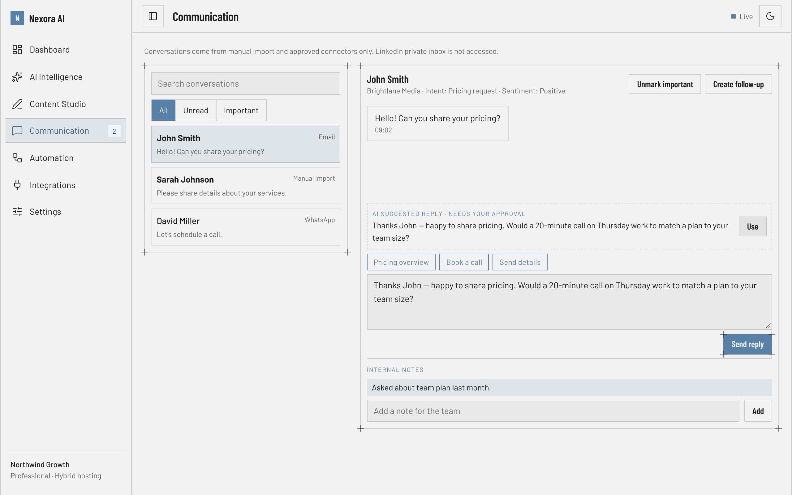
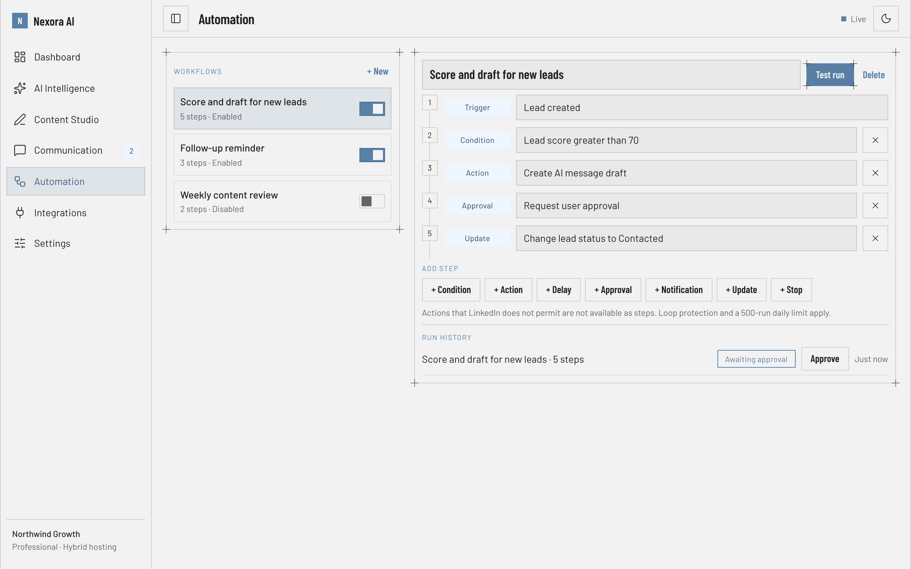
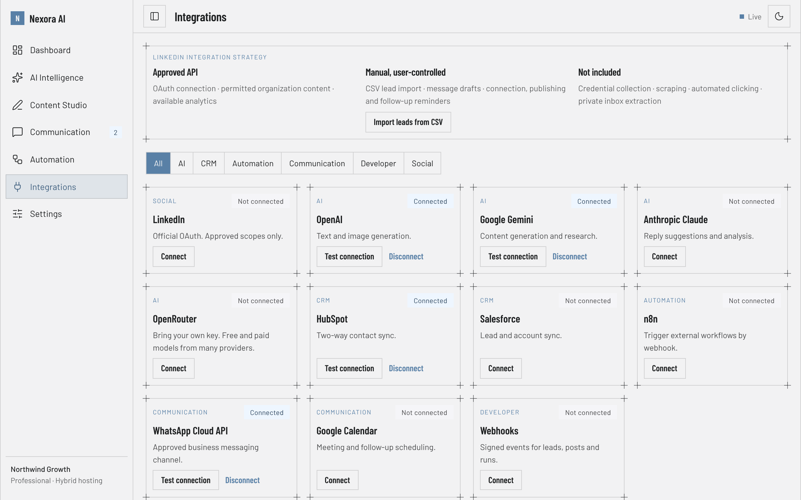
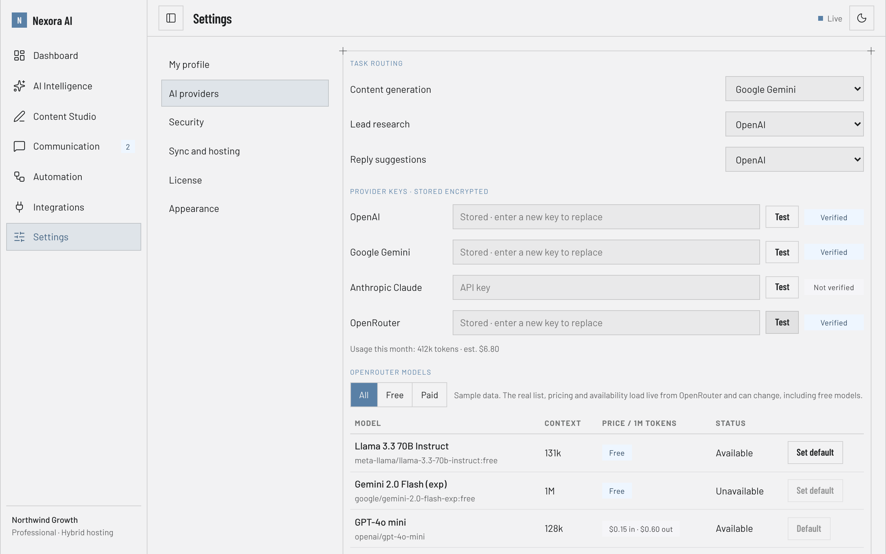
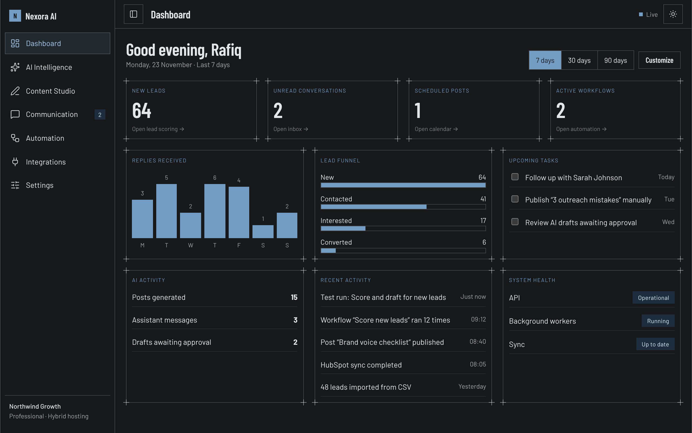
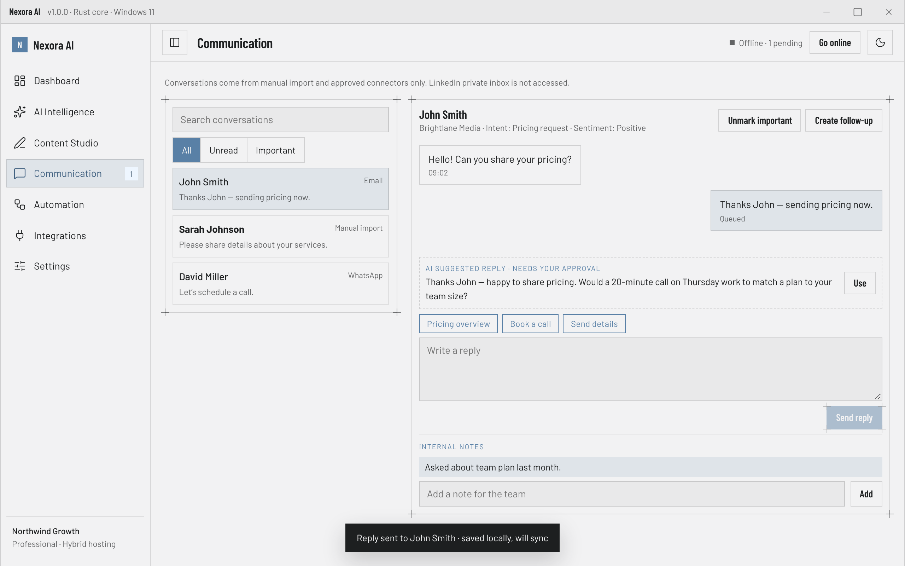
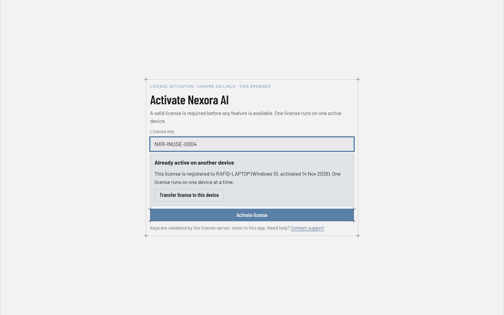

  

  <a href="README.md">Read in English</a> ·
  <a href="#এক-নজরে-দেখুন">ডেমো</a> ·
  <a href="#ডাউনলোড">ডাউনলোড</a> ·
  <a href="#প্ল্যান-এবং-কেন-সাবস্ক্রিপশন-দরকার">প্ল্যান</a> ·
  <a href="#সামনে-যা-আসছে">সামনের পরিকল্পনা</a>

# নেক্সোরা এআই (Nexora AI)

**নেক্সোরা এআই হলো LinkedIn-এর মাধ্যমে ব্যবসা বাড়ানোর একটি কাজের জায়গা (workspace)।** কোন লিডের
পেছনে সময় দেওয়া উচিত তা এটি দেখিয়ে দেয়, AI দিয়ে পোস্ট ও উত্তর লিখতে সাহায্য করে, সব কথোপকথন এক
ইনবক্সে রাখে — এবং LinkedIn যা অনুমতি দেয় না, এমন কিছু কখনো করে না।

একই অ্যাপ্লিকেশন ব্রাউজারে এবং Windows, macOS ও Linux-এ ডেস্কটপ অ্যাপ হিসেবে চলে; সব জায়গায় একই
ডেটা। তৈরি করেছেন [Mostafijemon24](https://github.com/Mostafijemon24)।

  

## এক নজরে দেখুন

  

৩৭ সেকেন্ডের ট্যুর: অ্যাক্টিভেশন, ড্যাশবোর্ড, লিড স্কোরিং, পোস্ট লেখা, উত্তর দেওয়া, অটোমেশন, ডার্ক মোড।
<a href="docs/media/nexora-ai-tour.mp4">ভিডিও ডাউনলোড করুন (MP4)</a>

## কাদের জন্য

- **উদ্যোক্তা ও একক পরামর্শদাতা** — যাঁরা LinkedIn থেকে ক্লায়েন্ট পান, কিন্তু লম্বা লিড-তালিকা হাতে বাছাই করার সময় নেই।
- **ছোট এজেন্সি ও সেলস টিম** — যাঁরা লিড, কনটেন্ট ও উত্তর এক জায়গায় চান।
- **যাঁরা নিজের LinkedIn অ্যাকাউন্ট ঝুঁকিতে ফেলতে চান না** — স্ক্র্যাপিং টুল বা অটো-ক্লিকার ব্যবহার না করে।

## কোন সমস্যার সমাধান করে

| নেক্সোরা এআই ছাড়া | নেক্সোরা এআই দিয়ে |
| --- | --- |
| ৫০০ লিডের তালিকা, কিন্তু কাকে আগে যোগাযোগ করবেন জানা নেই | প্রতিটি লিডের ০–১০০ স্কোর, কারণসহ |
| প্রতিবার পোস্ট লিখতে গিয়ে খালি পাতা | কয়েক সেকেন্ডে আপনার ব্র্যান্ডের ভাষায় খসড়া পোস্ট |
| উত্তর ছড়িয়ে আছে ইমেইল, WhatsApp ও নোটে | এক ইনবক্স, প্রতিটি কথোপকথনের জন্য প্রস্তাবিত উত্তর |
| ফলো-আপ ভুলে যাওয়া | যেকোনো কথোপকথন থেকে ফলো-আপ টাস্ক, ড্যাশবোর্ডে দেখা যায় |
| স্ক্র্যাপিং টুলে অ্যাকাউন্ট সীমিত হওয়ার ঝুঁকি | শুধু অফিসিয়াল সংযোগ ও নিজের হাতে করা ধাপ |
| ইন্টারনেট নেই, কাজ বন্ধ | ডেস্কটপ অ্যাপ অফলাইনে চলে, পরে নিজে থেকে সিঙ্ক হয় |

## কী কী করা যায়

### কার সাথে আগে কথা বলবেন তা জানুন

আপনার আদর্শ গ্রাহকের বর্ণনা একবার দিন — ইন্ডাস্ট্রি, পদবি, কোম্পানির আকার, অবস্থান। প্রতিটি লিড ১০০-র
মধ্যে একটি স্কোর পায়, সাথে হিসাবের ভাঙন। আলাদা একটি **কনফিডেন্স** সংখ্যা দেখায় স্কোরটি কতটা তথ্যের
ওপর দাঁড়িয়ে। কোনো তথ্য না থাকলে অ্যাপ লেখে *"Not available — not guessed"* এবং তার জন্য কোনো পয়েন্ট
দেয় না; কখনো বানিয়ে তথ্য বসায় না।

### খালি পাতা ছাড়াই পোস্ট লিখুন

বিষয়, পাঠক ও সুর (tone) দিন। হুক, মূল লেখা, কল-টু-অ্যাকশন ও হ্যাশট্যাগ পাবেন — সবই সম্পাদনাযোগ্য।
পোস্ট যায় **Draft → In review → Approved → Scheduled → Published** ধাপে, আর সাপ্তাহিক ক্যালেন্ডারে
দেখা যায় কোনটি কবে যাবে। আপনার অনুমোদন ছাড়া কিছুই প্রকাশ হয় না।

### এক জায়গা থেকে সব কথোপকথনের উত্তর দিন

প্রতিটি কথোপকথনে দেখা যায় মানুষটি কী চান এবং তাঁর সুর কেমন। AI একটি উত্তর প্রস্তাব করে, কিন্তু সেটি
শুধুই প্রস্তাব: আপনি **Use** চাপবেন, সম্পাদনা করবেন, নিজে পাঠাবেন।

### সহকারীকে জিজ্ঞেস করুন

নিজের লিড, পোস্ট ও উত্তর নিয়ে প্রশ্ন করুন। সহকারী শুধু আপনার workspace-এর তথ্য ব্যবহার করে, আর কিছু
না থাকলে তা জানিয়ে দেয়।

### নিজের ফলো-আপ প্রক্রিয়া সাজান

ধাপে ধাপে একটি workflow সাজান — ট্রিগার, শর্ত, AI খসড়া, অনুমোদন, স্ট্যাটাস পরিবর্তন। অনুমোদনের ধাপ
থাকলে workflow সবসময় থেমে আপনার জন্য অপেক্ষা করে।

### নিজের টুল যুক্ত করুন, নিজের AI ব্যবহার করুন

CRM, ক্যালেন্ডার ও মেসেজিং চ্যানেল যুক্ত করুন, এবং CSV ফাইল থেকে লিড আনুন। AI-এর জন্য নিজের key
ব্যবহার করবেন — **OpenAI, Google Gemini, Anthropic Claude বা OpenRouter** — কোন কাজে কোনটি চলবে তা
ঠিক করবেন, এবং মাসিক খরচের সীমা বসাবেন।

### পুরো ছবি এক পাতায়

ড্যাশবোর্ডে গত ৭, ৩০ বা ৯০ দিনের নতুন লিড, না-পড়া কথোপকথন, নির্ধারিত পোস্ট, লিড ফানেল ও টাস্ক
দেখা যায়। লাইট ও ডার্ক — দুই থিমই আছে।

### ইন্টারনেট ছাড়াও কাজ চালান

ডেস্কটপ অ্যাপে **Go offline** চাপুন বা সংযোগ চলে যাক: যা লিখবেন তা আপনার কম্পিউটারে জমা থাকে, এবং
সংযোগ ফিরলেই সার্ভারে চলে যায় — প্রতিটি পরিবর্তন ঠিক একবার।

### ফোনের মাপের পর্দায়

একই অ্যাপ ছোট পর্দায় নিজেকে সাজিয়ে নেয়, নিচে নেভিগেশন বারসহ। ইনস্টলযোগ্য Android অ্যাপ সামনের
পরিকল্পনায় আছে।

## কীভাবে কাজ করে

1. **অ্যাক্টিভেট করুন।** লাইসেন্স key একবার দিন। সার্ভার সেটি যাচাই করে আপনার ডিভাইস নিবন্ধন করে।
2. **কাজ করুন।** লিড, পোস্ট, কথোপকথন ও workflow সার্ভারে আপনার নিজস্ব workspace-এ থাকে, তাই ওয়েব ও ডেস্কটপে সবসময় একই জিনিস দেখা যায়।
3. **নিজের শর্তে AI ব্যবহার করুন।** AI-এর অনুরোধ সার্ভার দিয়ে যায় *আপনার* প্রোভাইডার key দিয়ে; key এনক্রিপ্ট করে রাখা হয় এবং কোনো ডিভাইসে আর ফেরত পাঠানো হয় না।
4. **নিয়ন্ত্রণ আপনার হাতে।** AI শুধু খসড়া করে। উত্তর পাঠানো, পোস্ট প্রকাশ, workflow অনুমোদন — সিদ্ধান্ত সবসময় আপনার।

## যা এটি কখনো করবে না

| ব্যবহার করে | ব্যবহার করে না |
| --- | --- |
| LinkedIn-এর অফিসিয়াল সাইন-ইন ও অনুমোদিত অনুমতি | আপনার LinkedIn পাসওয়ার্ড |
| CSV ইমপোর্ট, বার্তার খসড়া, রিমাইন্ডার | স্ক্র্যাপিং |
| যে চ্যানেল আপনি নিজে যুক্ত করেন | স্বয়ংক্রিয় ক্লিক বা গণ-কানেকশন রিকোয়েস্ট |
| | আপনার ব্যক্তিগত LinkedIn ইনবক্স পড়া |

## প্ল্যান এবং কেন সাবস্ক্রিপশন দরকার

সাবস্ক্রিপশন একবারের ডাউনলোড নয়; এটিই নেক্সোরা এআই-কে আপনার জন্য চালু রাখে। এর বিনিময়ে পাবেন:

- **আপনার লাইসেন্স** — যে key আপনার ডিভাইসে অ্যাপ খোলে এবং আপনার workspace সুরক্ষিত রাখে। এক লাইসেন্স একসাথে এক ডিভাইসে চলে; ইমেইলে আসা কোড দিয়ে নিজেই নতুন ডিভাইসে সরাতে পারবেন।
- **ক্লাউড workspace** — নিরাপদ সংরক্ষণ, ওয়েব ও ডেস্কটপের মধ্যে সিঙ্ক, এবং ব্যাকআপ।
- **AI-এর সার্ভার অংশ** — রাউটিং, ব্যবহারের হিসাব, খরচের সীমা ও এনক্রিপ্ট করা key সংরক্ষণ। (AI প্রোভাইডারের নিজস্ব খরচ আপনার নিজের key-তে প্রোভাইডারই নেয়, তাই যতটুকু ব্যবহার ততটুকুই খরচ।)
- **আপডেট ও নতুন ফিচার** — সামনের পরিকল্পনার সবকিছু, যখন যেটি আসবে।
- **সাপোর্ট** — কোনো সমস্যা হলে।

সক্রিয় লাইসেন্স ছাড়া অ্যাপ সব ডিভাইসে অ্যাক্টিভেশন স্ক্রিনেই থাকে।

| | Starter | Professional | Business |
| --- | --- | --- | --- |
| **মূল্য** | **$৯** / মাস | **$২৯** / মাস | **$৭৯** / মাস |
| লিড স্কোরিং, AI সহকারী, প্রম্পট লাইব্রেরি | ✓ | ✓ | ✓ |
| কনটেন্ট স্টুডিও ও ক্যালেন্ডার | ✓ | ✓ | ✓ |
| প্রস্তাবিত উত্তরসহ এক ইনবক্স | ✓ | ✓ | ✓ |
| Workflow বিল্ডার, ইন্টিগ্রেশন | | ✓ | ✓ |
| ওয়েব ও ডেস্কটপ অ্যাপ, অফলাইন মোড | | ✓ | ✓ |
| টিম মেম্বার, রোল, একাধিক workspace *(পরিকল্পিত)* | | | ✓ |
| অগ্রাধিকার সাপোর্ট *(পরিকল্পিত)* | | | ✓ |

> এই মূল্য ও প্ল্যানের বিষয়বস্তু উদ্বোধনের জন্য পরিকল্পিত প্রস্তাব; প্রকাশের আগে বদলাতে পারে। অনলাইন
> পেমেন্ট এখনো যুক্ত হয়নি — এখন লাইসেন্স সরাসরি মালিক ইস্যু করেন। তৃতীয় পক্ষের খরচ (AI প্রোভাইডার,
> LinkedIn API) আলাদা।

## ডাউনলোড

**Windows** (`.exe`, `.msi`), **macOS** (`.dmg`) ও **Linux** (`.deb`, `.rpm`, `.AppImage`)-এর ইনস্টলার
[Releases পাতায়](https://github.com/Mostafijemon24/Nexora-AI/releases) প্রকাশিত হয়।

বর্তমান ইনস্টলারগুলো **নমুনা ডেটায় চলা প্রিভিউ**, যাতে প্রতিটি স্ক্রিন ঘুরে দেখা যায়। ঢুকতে
`NXR-VALID-0001` key ব্যবহার করুন। এগুলো এখনো code-sign করা নয়, তাই Windows ও macOS প্রথমবার খোলার
সময় সতর্কবার্তা দেখাবে।

## প্রোটোটাইপ চালিয়ে দেখুন

- **এই repository থেকে, ব্রাউজারে:** `npm install && npm run dev`, তারপর `http://localhost:1420` খুলে
  `NXR-VALID-0001` দিয়ে অ্যাক্টিভেট করুন। ঠিকানার শেষে `?platform=android` (বা `windows`, `macos`,
  `linux`) যোগ করলে সেই লেআউট দেখা যায়।
- **মূল ক্লিকযোগ্য ডিজাইন প্রোটোটাইপ:** [`design/`](design) ফোল্ডারটি ডাউনলোড করে `Nexora AI.dc.html`
  খুলুন।

## সামনে যা আসছে

পূর্ণ তালিকা **[ROADMAP.md](ROADMAP.md)** ফাইলে। সংক্ষেপে:

- ইমেইল-পাসওয়ার্ড দিয়ে সাইন-ইন, টিম মেম্বার ও রোল
- অনলাইন পেমেন্ট ও নিজে থেকে সাবস্ক্রিপশন পরিচালনা
- ইমেইল ও WhatsApp-এ উত্তর পাঠানো এবং বার্তা স্বয়ংক্রিয়ভাবে আসা
- ট্রিগার হলে নিজে থেকে চলা workflow
- HubSpot, Salesforce ও Google Calendar-এর সাথে দ্বিমুখী সিঙ্ক
- Android অ্যাপ
- সাইন করা ইনস্টলার ও স্বয়ংক্রিয় আপডেট
- ক্যাম্পেইন ম্যানেজমেন্ট, পূর্ণাঙ্গ লিড CRM, বিস্তারিত অ্যানালিটিক্স ও রিপোর্ট

## যা এখনো তৈরি হয়নি

| বাকি কাজ | এখন কী অবস্থা | শুরু করতে কী লাগবে |
| --- | --- | --- |
| সার্ভার চালু করা | শুধু ডেভেলপমেন্ট মেশিনে চলেছে; ইনস্টলার নমুনা ডেটায় চলে | হোস্টিং, https ডোমেইন, PostgreSQL ডেটাবেস |
| AI প্রোভাইডার যাচাই | সংযোগ লেখা আছে, আসল key দিয়ে চালানো হয়নি | প্রতিটি প্রোভাইডারের একটি API key |
| LinkedIn, HubSpot, Salesforce, Google Calendar যাচাই | সংযোগের ধাপ তৈরি, আসল অ্যাকাউন্টে চালানো হয়নি | প্রতিটির ডেভেলপার অ্যাপ; LinkedIn-এর অনুমোদন |
| সাইন-ইন ও টিম মেম্বার | ডিভাইসে অ্যাক্টিভেট করা লাইসেন্সই একমাত্র পরিচয়; MFA সুইচ কাজ করে না | সাইন-ইন ও টিম স্ক্রিনের ডিজাইন |
| অনলাইন পেমেন্ট | লাইসেন্স কমান্ড দিয়ে তৈরি করতে হয় | পেমেন্ট প্রোভাইডারের অ্যাকাউন্ট |
| বার্তা পাঠানো ও গ্রহণ | উত্তর সংরক্ষিত হয়, কোথাও পাঠানো হয় না | ইমেইল ও WhatsApp Business অ্যাকাউন্ট |
| Workflow নিজে থেকে চলা | সাজানো ও টেস্ট-রান করা যায়, ধাপ কার্যকর হয় না | প্রতিটি ধাপ ঠিক কী করবে তার সংজ্ঞা |
| ইন্টিগ্রেশনের ডেটা সিঙ্ক | যুক্ত করা যায়, ডেটা আদান-প্রদান হয় না | ওপরের অ্যাকাউন্টগুলো |
| Android অ্যাপ | ফোনের মাপে লেআউট কাজ করে; ইনস্টলযোগ্য অ্যাপ নেই | নিরাপদ সেশন সংরক্ষণের পদ্ধতি, Play Store অ্যাকাউন্ট |
| Code signing ও স্বয়ংক্রিয় আপডেট | ইনস্টলার সাইন করা নয় | Windows সার্টিফিকেট, Apple Developer অ্যাকাউন্ট |
| ব্যাকআপ পুনরুদ্ধার | ব্যাকআপ জমা হয়, ফেরত আনা যায় না | — |
| CRM, ক্যাম্পেইন, অ্যানালিটিক্স মডিউল | মূল পরিকল্পনায় ছিল, সংস্করণ ১-এ নেই | — |

## লাইসেন্স

© ২০২৬ Mostafijemon24। সর্বস্বত্ব সংরক্ষিত।
