<p align="center">
  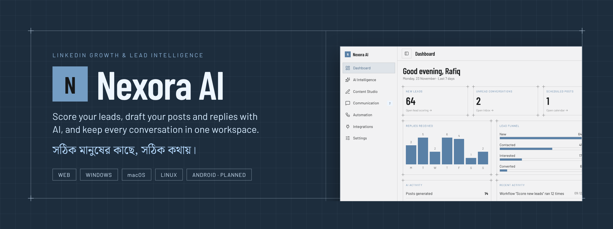
</p>

<p align="center">
  <a href="README.bn.md">বাংলায় পড়ুন</a> ·
  <a href="#see-it-in-action">Demo</a> ·
  <a href="#download">Download</a> ·
  <a href="#plans-and-why-a-subscription">Plans</a> ·
  <a href="ROADMAP.md">Roadmap</a> ·
  <a href="#for-developers">Developers</a>
</p>

<p align="center">
  <a href="https://github.com/Mostafijemon24/Nexora-AI/actions/workflows/ci.yml"></a>
</p>

# Nexora AI

**Nexora AI is a workspace for growing a business through LinkedIn.** It tells you which leads are
worth your time, helps you write posts and replies with AI, keeps every conversation in one inbox,
and never does anything on LinkedIn that LinkedIn does not allow.

It is one application that runs in the browser, as a desktop app on Windows, macOS and Linux, and
on Android, with the same data everywhere. Created by [Mostafijemon24](https://github.com/Mostafijemon24).

## See it in action

<p align="center">
  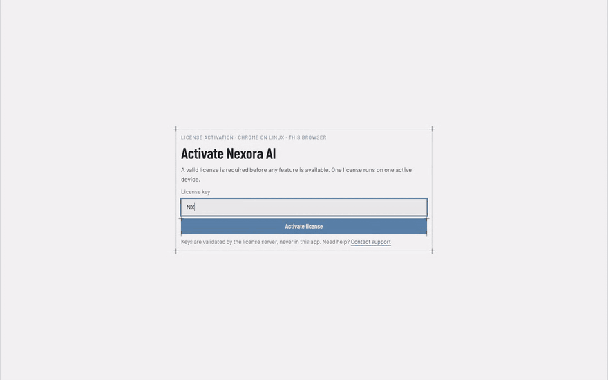
</p>

<p align="center"><sub>A 37-second tour: activation, dashboard, lead scoring, writing a post, replying, automation, dark mode.
<a href="docs/media/nexora-ai-tour.mp4">Download the video (MP4)</a></sub></p>

## Who it is for

- **Founders and solo consultants** who find clients on LinkedIn and have no time to sort a long lead list by hand.
- **Small agencies and sales teams** who want one place for leads, content and replies instead of five tabs and a spreadsheet.
- **Anyone who refuses to risk their LinkedIn account** on scraping tools and auto-clickers.

## The problem it solves

| Without Nexora AI | With Nexora AI |
| --- | --- |
| A list of 500 leads and no idea who to contact first | Every lead scored 0–100 against your ideal customer, with the reason shown |
| A blank page every time you need to post | A draft post in your brand voice in seconds, which you edit and approve |
| Replies scattered across email, WhatsApp and notes | One inbox, with a suggested reply for each conversation |
| Follow-ups forgotten | Workflows that create tasks, move leads and draft messages by themselves |
| A CRM, a calendar and a mailbox that never agree | Two-way sync with HubSpot, Salesforce and Google Calendar; email and WhatsApp in one inbox |
| Tools that scrape LinkedIn and get accounts restricted | Official connections and manual steps only — nothing automated behind your back |
| No internet, no work | The desktop app keeps working offline and syncs when you are back |

## What you can do with it

### Know who to talk to first

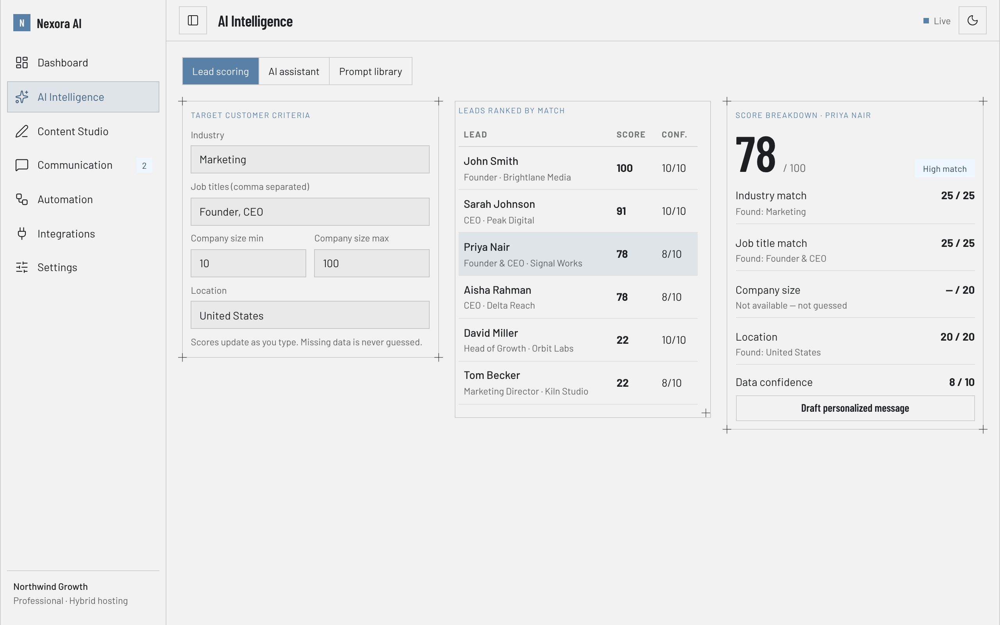

Describe your ideal customer once — industry, job titles, company size, location. Every lead gets a
score out of 100 and a breakdown of how it was reached. A separate **confidence** number shows how
much data the score rests on. If a detail is missing, Nexora AI says *"Not available — not guessed"*
and gives no points for it; it never makes facts up.

### Keep every lead moving

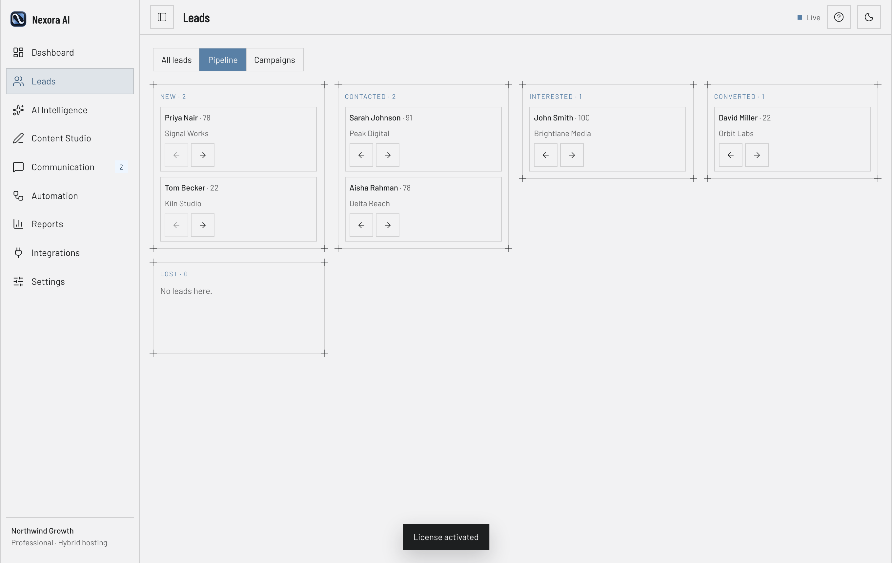

Each lead has a stage — New, Contacted, Interested, Converted or Lost — along with contact details,
tags and notes. Search and filter the list, change many leads at once, drag them through the
pipeline, and group them into campaigns that show how many were contacted, replied and converted.
Import and export are plain CSV files.

### Write posts without the blank page

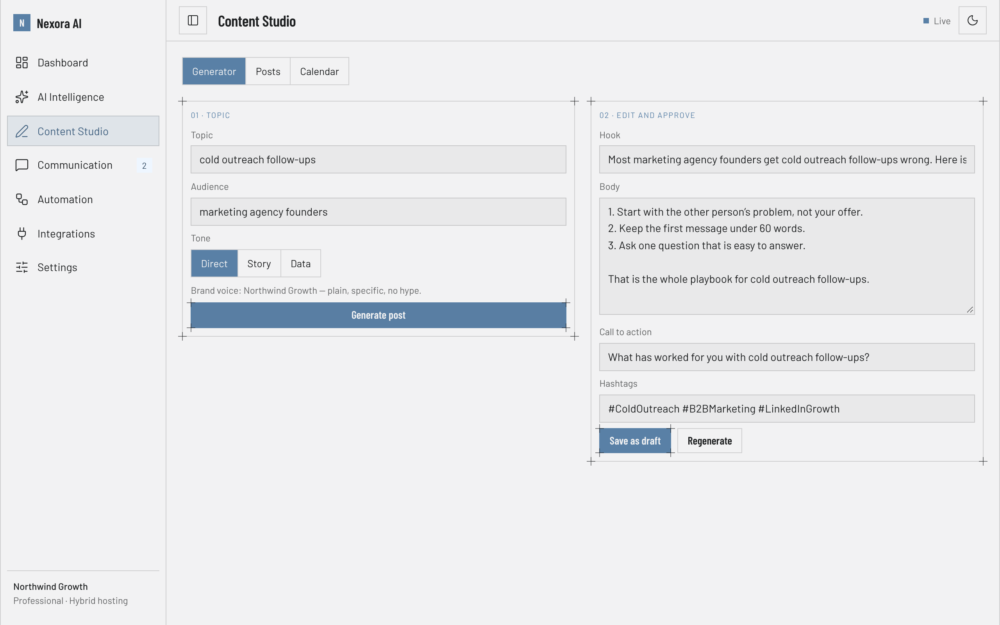

Give a topic, an audience and a tone. You get a hook, a body, a call to action and hashtags, all
editable. Posts move through **Draft → In review → Approved → Scheduled → Published**, and a weekly
calendar shows what goes out when. With LinkedIn connected, an approved post is published through
LinkedIn's official API when you press Publish — or by itself on its scheduled day, if you switch
that on. Nothing is published without your approval.

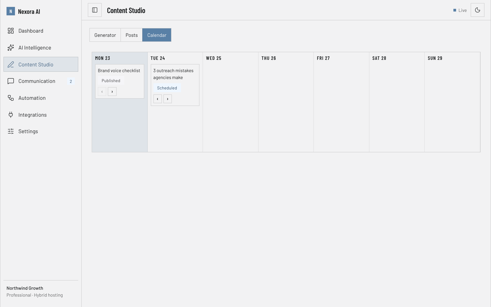

### Answer every conversation from one place

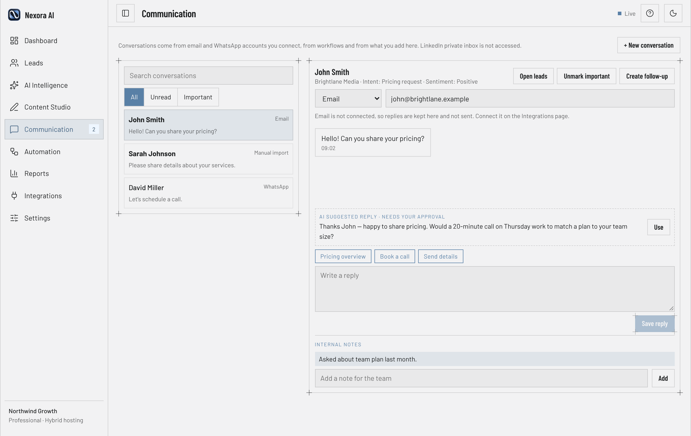

Connect your own mailbox and your WhatsApp Business number: incoming messages appear in the inbox,
linked to the lead they came from, and your reply goes out on the same channel. Each reply shows
whether it was sent. The AI suggests a reply, but it is only a suggestion: you press **Use**, edit
it, and send it yourself. Internal notes stay with the conversation for your team.

### Ask the assistant

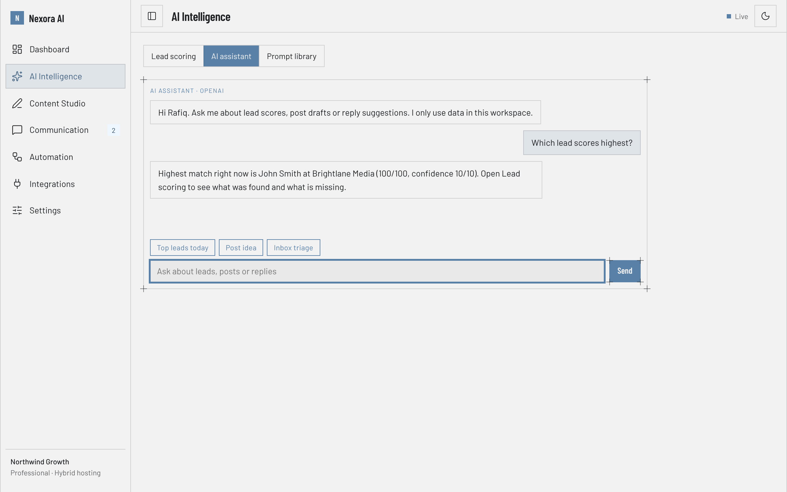

Ask about your own leads, posts and replies. The assistant only uses the data in your workspace and
tells you when something is missing.

### Let the follow-up run by itself

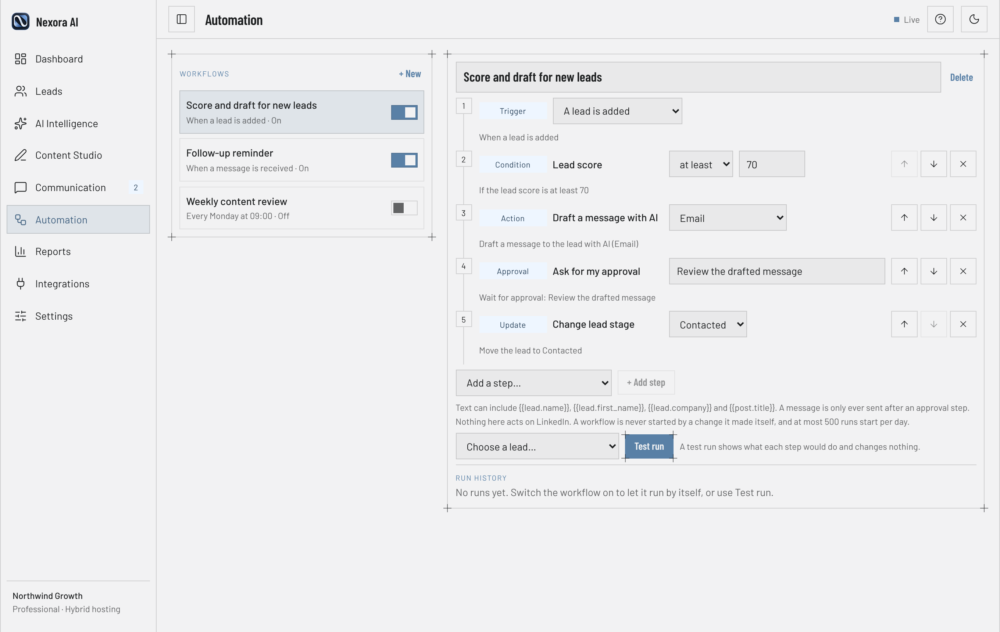

Build a workflow from steps: a trigger (a new lead, a stage change, a received message, a post
status, a schedule), then conditions, waits, approvals and actions — tag or move the lead, create a
task, draft a message with AI, notify the workspace, call a webhook. Switched on, it runs by itself.
A message is only ever sent after an approval step, a test run shows what would happen without
changing anything, and nothing acts on LinkedIn.

### Connect your tools, and bring your own AI

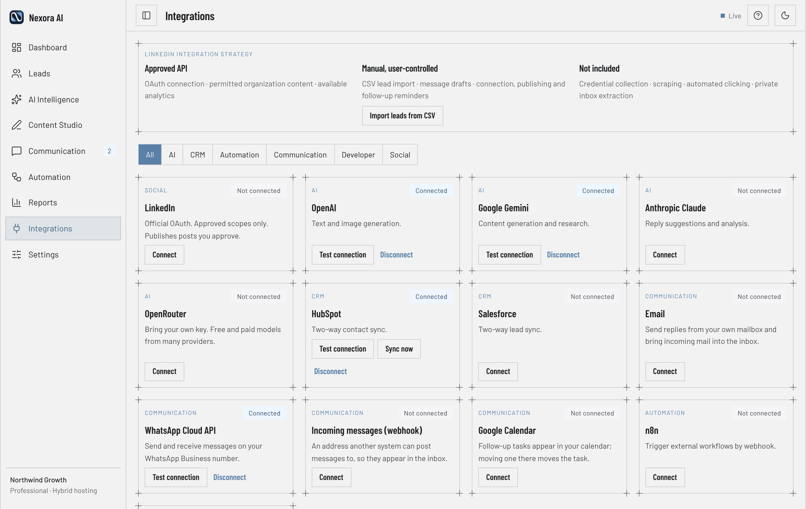

Connect HubSpot or Salesforce (leads sync both ways), Google Calendar (follow-up tasks appear in
your calendar), email, WhatsApp, n8n and signed webhooks. For AI you use your own key with
**OpenAI, Google Gemini, Anthropic Claude or OpenRouter**, choose which one handles each kind of
task, and set a monthly spending limit.

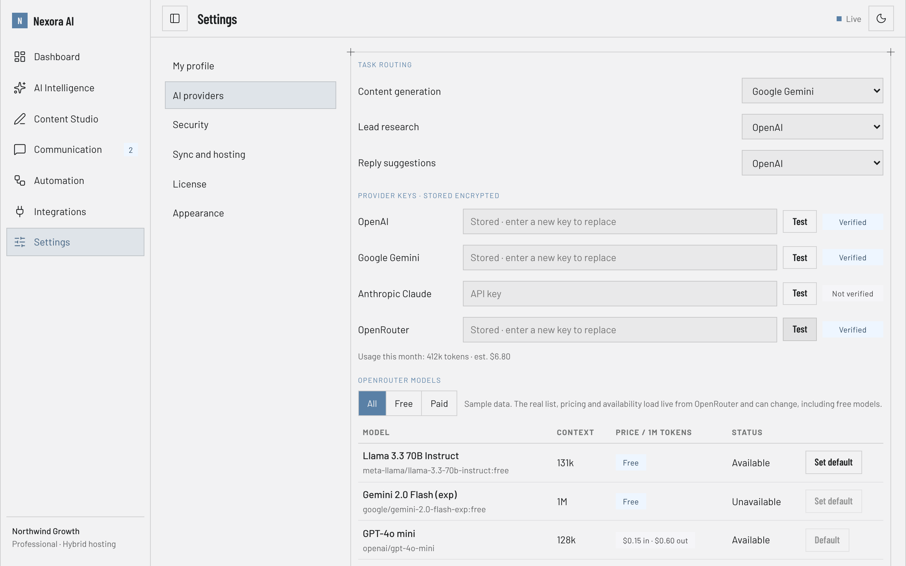

### See the whole picture

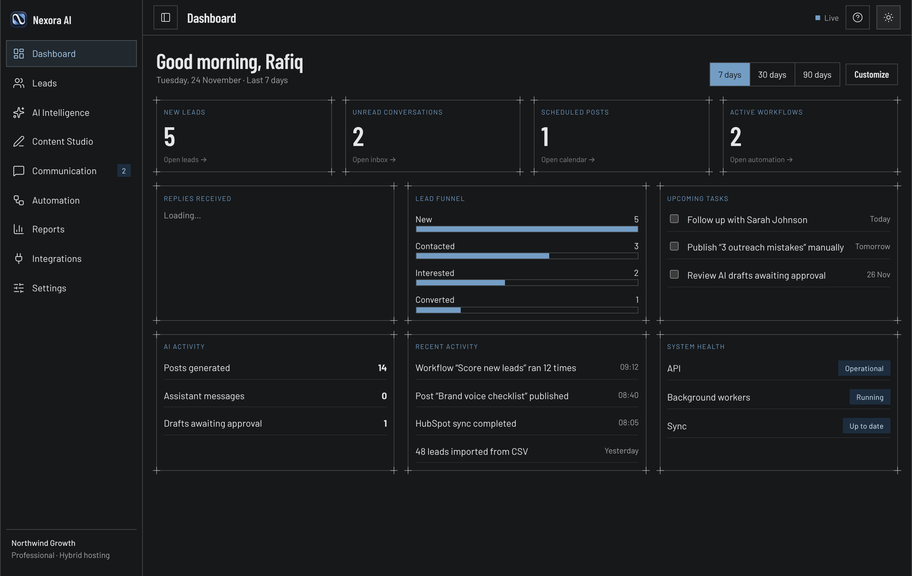

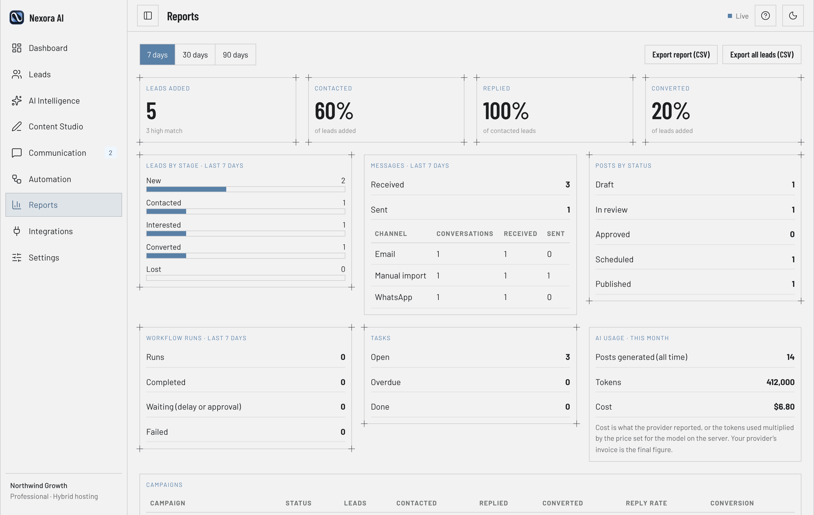

The dashboard shows new leads, unread conversations, scheduled posts, the lead funnel and your
tasks for the last 7, 30 or 90 days. The Reports page adds contact, reply and conversion rates,
campaign results, messages by channel and AI cost per provider, all exportable as CSV. Light and
dark themes are both built in.

### Work as a team

Set a password and invite teammates by email; each signs in with their own account and takes one
of the license's seats, without ever seeing the license key. Roles (owner, admin, member, viewer)
decide who may change what. Two-step sign-in with an authenticator app can be switched on per
person or required for everyone. An agency can keep a separate workspace for each client.

### Keep working without internet

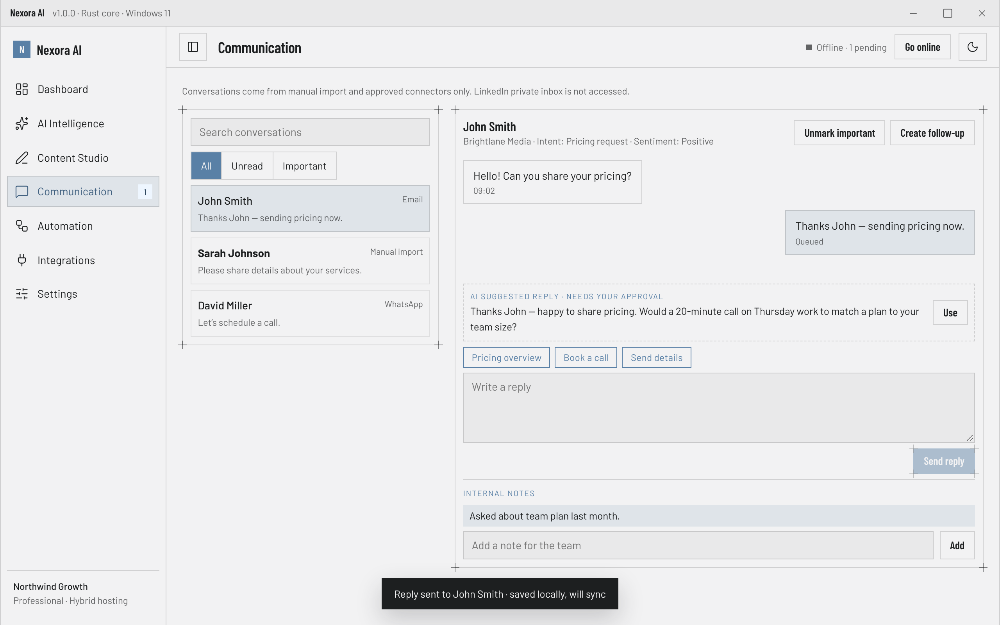

On the desktop app, press **Go offline** or simply lose your connection: what you write is saved on
your computer, counted in the header, and sent to the cloud the moment you reconnect — each change
exactly once.

### On a phone-sized screen

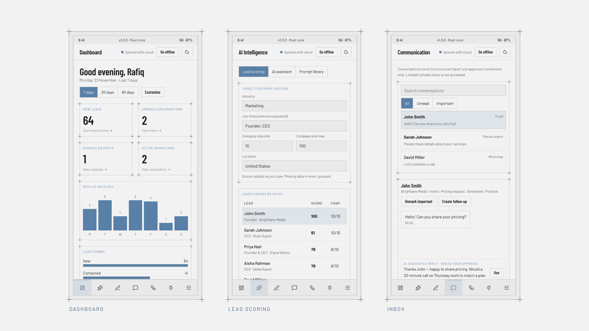

The same app rearranges itself for a small screen with a bottom navigation bar, in a phone browser
and in the Android app.

## How it works

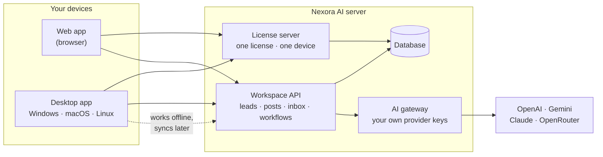

1. **Activate.** You enter your license key once, or sign in with your account. The server checks it and registers your device.
2. **Work.** Your leads, posts, conversations and workflows live in your own workspace on the server, so the web and desktop apps always show the same thing.
3. **Use AI on your terms.** AI requests go through the server with *your* provider key, which is stored encrypted and never sent back to any device.
4. **Stay in control.** AI only drafts. Sending a reply, publishing a post and approving a workflow run are always your decision.

## What it will never do

Nexora AI is built to keep your LinkedIn account safe.

| Uses | Does not use |
| --- | --- |
| LinkedIn's official sign-in and approved permissions | Your LinkedIn password |
| CSV import, message drafts, reminders you act on | Scraping |
| Channels you connect yourself | Automated clicking or mass connection requests |
| | Reading your private LinkedIn inbox |

## Plans and why a subscription

A subscription is what keeps Nexora AI running for you, not a one-off download. It pays for:

- **Your license** — the key that unlocks the app on your device and protects your workspace. One license runs on one device at a time; you can move it to a new device yourself with an email code.
- **The cloud workspace** — secure storage, sync between web and desktop, and backups.
- **The server side of AI** — routing, usage tracking, spending limits and encrypted key storage. (The AI provider's own usage is billed by the provider to your own key, so you only pay for what you use.)
- **Updates and new features** — everything on the [roadmap](ROADMAP.md), as it ships.
- **Support** when something goes wrong.

Without an active license the app stays on the activation screen, on every device.

| | Starter | Professional | Business |
| --- | --- | --- | --- |
| **Price** | **$9** / month | **$29** / month | **$79** / month |
| Lead scoring, AI assistant, prompt library | ✓ | ✓ | ✓ |
| Content studio and calendar | ✓ | ✓ | ✓ |
| Unified inbox with suggested replies | ✓ | ✓ | ✓ |
| Workflows that run by themselves, integrations and sync | | ✓ | ✓ |
| Desktop and Android apps, offline mode | | ✓ | ✓ |
| Team members, roles, several workspaces (5 devices) | | | ✓ |
| Priority support | | | ✓ |

The server enforces these limits. There are also annual plans, a one-payment **Lifetime desktop**
license and an **Enterprise** plan (25 devices, everything included).

> These prices and plan contents are the intended launch offer and may change before public
> launch; the annual, lifetime and enterprise prices in particular are placeholders. Online
> payment is not connected yet — today licenses are issued directly by the owner.
> Third-party costs (your AI provider, LinkedIn API access) are separate.

## Download

Installers for **Windows** (`.exe`, `.msi`), **macOS** (`.dmg`, Apple Silicon and Intel) and
**Linux** (`.deb`, `.rpm`, `.AppImage`) are published on the
[Releases page](https://github.com/Mostafijemon24/Nexora-AI/releases). The web app is at
**https://linkdin.avonixai.com**.

Until a server is connected, the installers and the web app **run without one**. Use the key
`NXR-VALID-0001` to get in. The workspace starts empty and a short tour introduces each page the
first time you open it (the **?** button in the header replays it). What you add is kept on that
device, and workflows run while the app is open. Without a server nothing can be connected or sent
— integrations, AI provider keys, email, WhatsApp, accounts and team members all live on the server
— and AI answers are built-in examples. To use a server, enter its address under *Use a different
server* on the first screen, or in Settings → Hosting and backups.

The installers are not code-signed yet, so Windows and macOS will show a warning the first time you
open them.

**macOS, first launch.** If macOS says the app cannot be verified, open **System Settings → Privacy
& Security** and click **Open Anyway**. If it says *"Nexora AI.app" is damaged and can't be opened*,
the app is not damaged — macOS blocks unsigned downloads this way. Click **Cancel** (not *Move to
Trash*), move the app to **Applications**, then run this once in Terminal and open the app again:

```bash
xattr -cr "/Applications/Nexora AI.app"
```

## Try the prototype

- **In your browser, from this repository:** `npm install && npm run dev`, open
  `http://localhost:1420`, and activate with `NXR-VALID-0001`. Add `?platform=android` (or
  `windows`, `macos`, `linux`) to the address to preview that layout, or `?sample` to fill the
  workspace with sample data.
- **The original clickable design prototype:** download the [`design/`](design) folder and open
  `Nexora AI.dc.html`. It is the design the app was built from.

Other sample keys show each activation outcome: `NXR-EXPIRED-0002`, `NXR-REVOKED-0003`,
`NXR-INUSE-0004` (transfer with any 6-digit code), `NXR-OFFLINE-0005`.

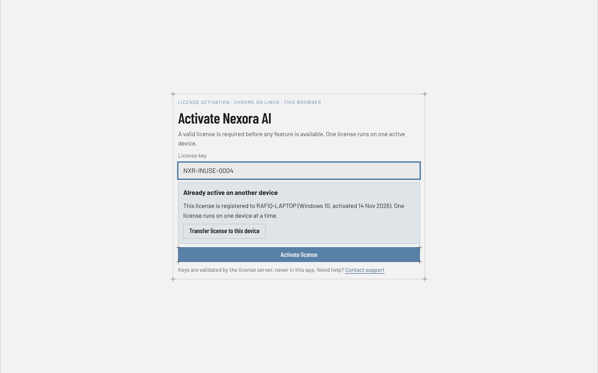

## What is coming next

The product features on the earlier roadmap are built. What remains is mostly switching things on
with real accounts — the full list is in **[ROADMAP.md](ROADMAP.md)**.

- Putting the server on a VPS and pointing the apps at it
- Real accounts for email, WhatsApp, the CRMs, LinkedIn and the AI providers
- Online payment and self-service subscription management
- Signed installers; a signing key for automatic updates; an Android release build
- WhatsApp template messages, email attachments, single sign-on, an iOS app

## For developers

| Part | Where | Built with |
| --- | --- | --- |
| App (web, desktop and Android UI) | [`src/`](src) | React, TypeScript, Vite |
| Rules shared by the app and the server (workflow engine, scoring, reports) | [`src/lib/`](src/lib) | TypeScript |
| Desktop and Android shell | [`src-tauri/`](src-tauri) | Tauri 2, Rust, Kotlin |
| Offline queue and license-token verification | [`crates/nexora-core/`](crates/nexora-core) | Rust, SQLite, Ed25519 |
| API, license server, accounts, workflows, messaging, sync, AI gateway | [`backend/`](backend) | Node 22, PostgreSQL, optional Redis |
| Server install for a VPS | [`deploy/`](deploy) | Docker Compose, Caddy |
| Design reference | [`design/`](design) | HTML prototype and design system |

```bash
npm install
npm run dev              # web app without a server, http://localhost:1420 (add ?sample for sample data)
npm run tauri dev        # desktop app (needs the Tauri 2 prerequisites)
npm test                 # app tests
cargo test --workspace   # Rust tests
```

To run the server on your own machine, follow **[backend/README.md](backend/README.md)**; to put it
on a VPS, **[deploy/README.md](deploy/README.md)**.
What has been built, what has been verified and how is recorded in
**[PROJECT_STATUS.md](PROJECT_STATUS.md)**.

Every push to `main` runs all three test suites on GitHub Actions and publishes the web app; the
*Release installers* workflow builds the desktop installers, and *Platforms* builds and starts the
app on Windows, macOS, Linux and Android.

## License

© 2026 Mostafijemon24. All rights reserved. This source code is published for reference; it may
not be copied, modified or redistributed without written permission.
